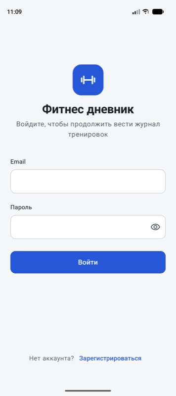
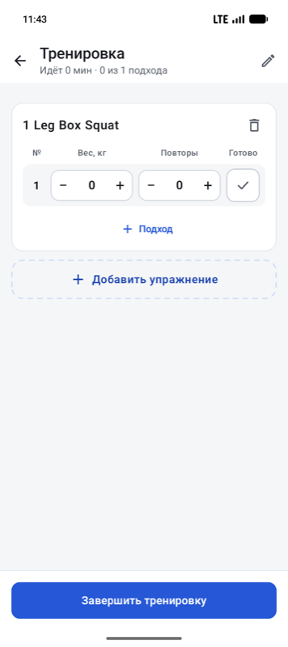
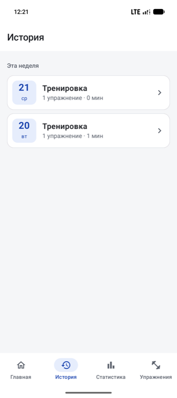
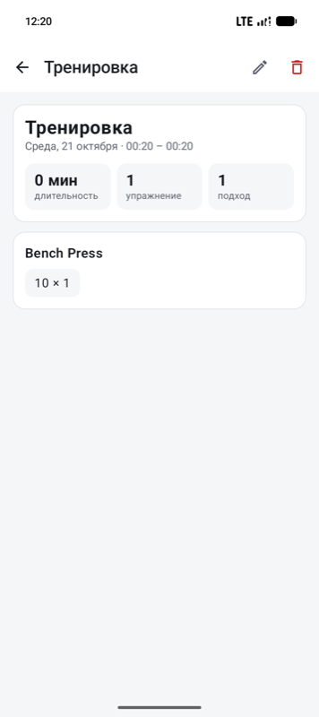
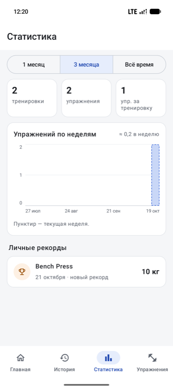
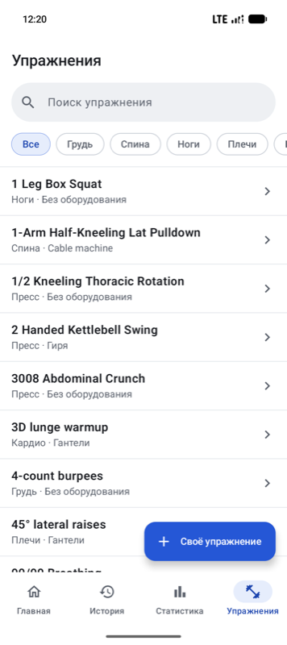
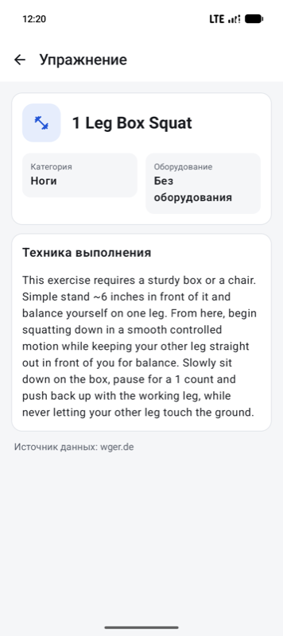
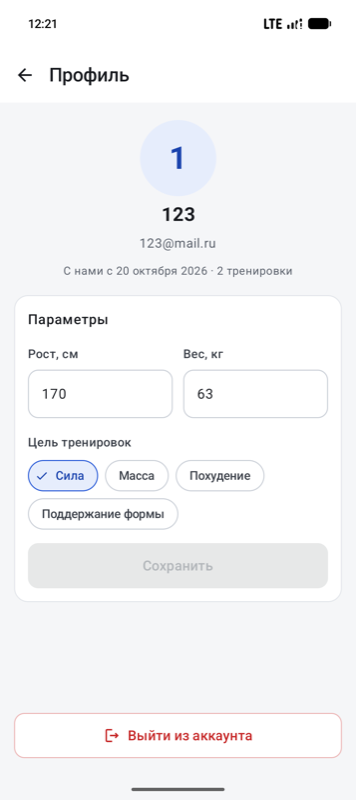

# Фитнес дневник

Android-приложение для ведения журнала силовых тренировок. Пользователь регистрируется, записывает тренировки (упражнения, подходы с весом и повторениями), смотрит историю и статистику прогресса. Каталог упражнений загружается из открытого API [wger](https://wger.de/api/v2/) и работает без сети из локального кэша.

Учебный проект по дисциплине «Технологии разработки мобильных приложений». Команда из двух человек, код в репозитории [Aveyi/fitness-app](https://github.com/Aveyi/fitness-app).

## Содержание

- [Возможности](#возможности)
- [Скриншоты](#скриншоты)
- [Установка и запуск](#установка-и-запуск)
- [Тестирование](#тестирование)
- [Архитектура](#архитектура)
- [Библиотеки](#библиотеки)
- [Обфускация](#обфускация)
- [Команда](#команда)

## Возможности

| Экран | Что умеет |
|---|---|
| Вход и регистрация | Локальные аккаунты: имя, email, пароль, рост, вес, цель тренировок. Проверка полей с подсказками под каждым, шкала надёжности пароля. Сессия сохраняется между запусками |
| Главная | Приветствие, кнопка «Начать тренировку» или «Продолжить», если есть незавершённая. Итоги недели: тренировки, упражнения, время в зале. Мини-график за 6 недель и последняя тренировка |
| Тренировка | Добавление упражнений из каталога, подходы со степперами веса (±2,5 кг) и повторений, отметка выполнения, таймер отдыха 90 секунд, переименование, завершение с заметкой |
| История | Завершённые тренировки по неделям. Удаление свайпом с возможностью отменить |
| Детали тренировки | Дата и время, длительность, упражнения и подходы («80 × 8»), редактирование и удаление |
| Статистика | Период: 1 месяц, 3 месяца, всё время. Тренировки, выполненные упражнения, среднее за тренировку, график по неделям с лучшей неделей, личные рекорды |
| Упражнения | Каталог из wger и свои упражнения: поиск, фильтр по категории, обновление свайпом вниз, создание своего упражнения. Режим выбора для экрана Тренировка |
| Детали упражнения | Категория, оборудование, описание техники |
| Профиль | Данные пользователя, редактирование роста, веса и цели, выход из аккаунта |

Требования методички закрыты так:

- **10 экранов** при минимуме 4, нижняя навигация и переходы между экранами;
- **3 собственных компонента** при минимуме 2: `ProgressChart`, `PasswordStrengthIndicator`, `SetRow`;
- **хранение данных:** Room и DataStore;
- **сеть:** REST API wger;
- **авторизация:** регистрация и вход, пароли хранятся как хеш PBKDF2;
- **обфускация:** R8;
- **модульные тесты:** 141 тест.

## Скриншоты

| Вход | Главная | Тренировка |
|:---:|:---:|:---:|
|  |  |  |
| **История** | **Детали тренировки** | **Статистика** |
|  |  |  |
| **Упражнения** | **Детали упражнения** | **Профиль** |
|  |  |  |

Макеты всех экранов лежат в [`design/`](design/) (файл Figma).

## Установка и запуск

### Требования

- **Android Studio** последней стабильной версии: в неё уже входит подходящий JDK;
- **Android SDK Platform 37** (API 37): Android Studio предложит скачать при первом открытии проекта;
- **устройство или эмулятор** на Android 8.0 (API 26) или новее, с интернетом для загрузки каталога упражнений.

Отдельно ставить Gradle не нужно: в проекте есть Gradle Wrapper (`gradlew`). Код компилируется под JDK 17. Если его нет на компьютере, Gradle скачает его сам (плагин `foojay-resolver`).

### Через Android Studio

1. Склонировать репозиторий:
   ```bash
   git clone git@github.com:Aveyi/fitness-app.git
   ```
2. В Android Studio: **File → Open** → папка `fitness-app`. Дождаться окончания Gradle Sync.
3. Выбрать устройство или эмулятор и нажать **Run ▶** (конфигурация `app`).

> На Windows клонируйте проект в путь без кириллицы и пробелов, например `C:\dev\fitness-app`.

### Из командной строки

```bash
./gradlew assembleDebug        # собрать debug-APK
./gradlew installDebug         # собрать и установить на подключённое устройство
./gradlew assembleRelease      # собрать release-APK (R8, сжатие ресурсов)
```

Готовые APK:

- `app/build/outputs/apk/debug/app-debug.apk`
- `app/build/outputs/apk/release/app-release.apk`

Release-сборка подписывается debug-ключом. Для учебного проекта этого достаточно, её можно сразу поставить на устройство.

Если Gradle не находит Java, укажите JDK 17 или новее, например на macOS:

```bash
export JAVA_HOME=$(/usr/libexec/java_home -v 21)
```

## Тестирование

Модульные тесты: 141 тест в 19 классах.

```bash
./gradlew testDebugUnitTest                                   # все юнит-тесты
./gradlew testDebugUnitTest --rerun                           # прогнать заново, даже если код не менялся
./gradlew testDebugUnitTest --tests "*StatsCalculatorTest"    # один класс
```

HTML-отчёт после прогона: `app/build/reports/tests/testDebugUnitTest/index.html`.

В Android Studio: правый клик по `app/src/test/java` → **Run 'Tests in 'java''**.

| Что проверяется | Классы |
|---|---|
| Хеширование паролей и проверка полей | `PasswordHasherTest`, `ValidatorsTest`, `PasswordStrengthTest` |
| Сессия и авторизация | `SessionRepositoryTest`, `RoomAuthRepositoryTest`, `LoginViewModelTest`, `RegisterViewModelTest` |
| Статистика: суммы, недели, рекорды | `StatsCalculatorTest`, `StatsViewModelTest`, `ProgressChartScaleTest` |
| Главная и профиль | `HomeViewModelTest`, `ProfileViewModelTest` |
| Тренировки | `RoomWorkoutRepositoryTest`, `WorkoutViewModelTest`, `WorkoutDetailsViewModelTest`, `WeekGroupingTest` |
| Каталог упражнений и wger | `DefaultExerciseRepositoryTest`, `WgerMapperTest`, `HtmlCleanerTest` |

Тесты не зависят от устройства. Вместо Room и сети в них подставляются фейковые DAO и репозитории, а DataStore пишет во временный файл. Время в тестах фиксированное (`Clock.fixed`), поэтому расчёты по неделям не зависят от дня запуска.

## Архитектура

**MVVM + Repository** с однонаправленным потоком данных:

```
Compose-экран ──события──▶ ViewModel ──▶ Repository ──▶ Room (DAO) / Retrofit (wger) / DataStore
      ▲                       │
      └──── StateFlow<UiState> ◀┘
```

- **Экран** только рисует `UiState` и передаёт события во ViewModel. Про `NavController` экраны не знают: переходы приходят к ним лямбдами.
- **ViewModel** хранит состояние в `StateFlow` и вызывает репозитории.
- **Repository** — единственная точка доступа к данным. Наружу он отдаёт доменные модели (`User`, `Workout`, `Exercise`), а не сущности Room и не DTO.
- **DI ручной**, через `AppContainer` (без Hilt). `FitnessApp` создаёт `DefaultAppContainer`, а ViewModel получает репозитории через фабрику `viewModelFactory`.

### Структура пакетов

```
app/src/main/java/ru/pacani/fitnessdiary/
├── FitnessApp.kt, MainActivity.kt   # Application с AppContainer; Activity со splash
├── di/                    # AppContainer
├── data/
│   ├── auth/              # PasswordHasher (PBKDF2)
│   ├── session/           # SessionRepository (DataStore)
│   ├── local/             # AppDatabase, entity/, dao/, relation/, мапперы
│   ├── remote/            # WgerApi (Retrofit), DTO, очистка HTML
│   └── repository/        # Auth-, Workout-, Exercise-, StatsRepository
├── domain/
│   ├── model/             # User, Workout, Exercise, ...
│   ├── stats/             # StatsCalculator: суммы, недели, рекорды
│   └── validation/        # Validators, оценка надёжности пароля
└── ui/
    ├── navigation/        # Type-safe маршруты, NavHost, нижняя панель
    ├── theme/             # Цвета, шрифты, формы из макетов
    ├── components/        # Собственные компоненты и общие элементы
    └── auth/, home/, workout/, history/, stats/, exercises/, profile/
```

### Навигация

Navigation Compose с **type-safe маршрутами** (`@Serializable`-классы в `ui/navigation/Routes.kt`). Маршруты собраны в два графа:

- **auth:** Вход ↔ Регистрация;
- **main:** четыре вкладки нижней панели (Главная, История, Статистика, Упражнения) и вложенные экраны (Тренировка, Детали тренировки, Детали упражнения, Профиль).

Стартовый граф выбирается по сохранённой сессии. Пока сессия проверяется, на экране держится системный splash. После входа и выхода back stack очищается. Выбранное в каталоге упражнение возвращается на экран Тренировка через `savedStateHandle` (ключ `pickedExerciseId`).

### Данные

База Room, 5 таблиц:

```
users ─┬─< workouts ─< workout_exercises ─< sets
       └─< exercises >──────┘
```

| Таблица | Содержимое |
|---|---|
| `users` | Имя, email (уникальный), хеш пароля и соль, рост, вес, цель |
| `exercises` | Упражнения из wger (`remoteId`) и собственные упражнения пользователя |
| `workouts` | Тренировки пользователя; `finishedAt = null` — тренировка идёт |
| `workout_exercises` | Упражнения в тренировке с порядком |
| `sets` | Подходы: вес, повторения, отметка выполнения |

Схема экспортируется в `app/schemas/`. Статистика не хранится в базе, а считается из тренировок: число тренировок, выполненные упражнения (те, где отмечен хотя бы один подход), время в зале, рекорды как максимальный вес по упражнению.

### Авторизация

Авторизация локальная, своего сервера у приложения нет.

- **Пароль** хранится только как хеш **PBKDF2WithHmacSHA256**: 120 000 итераций, 256 бит, случайная соль 16 байт. Хеши сравниваются за постоянное время (`MessageDigest.isEqual`).
- **Email** приводится к нижнему регистру.
- **Неверный email и неверный пароль** дают одно и то же сообщение. Для неизвестного email хеш тоже считается, чтобы по времени ответа нельзя было понять, зарегистрирован ли адрес.
- **Сессия** — это id пользователя в DataStore.

### Сеть

[wger REST API](https://wger.de/api/v2/), публичные эндпоинты без ключа: `exerciseinfo/` и `language/`. Используются Retrofit, OkHttp и kotlinx.serialization.

- **Источник данных — Room.** Экран каталога всегда читает упражнения из базы.
- **Загрузка из сети** выполняется при первом запуске и при обновлении свайпом вниз. Записи обновляются по `remoteId`.
- **Без сети** показывается кэш, а свои упражнения доступны всегда.
- **Названия** берутся на русском, если в wger есть перевод, иначе на английском. HTML в описаниях очищается.
- **Логи запросов** пишутся только в debug-сборке.

## Библиотеки

Все версии собраны в [`gradle/libs.versions.toml`](gradle/libs.versions.toml).

| Библиотека | Версия | Назначение |
|---|---|---|
| Kotlin | 2.4.21 | Язык (встроен в AGP 9) |
| Android Gradle Plugin | 9.4.1 | Сборка, R8 |
| Gradle | 9.8.2 | Система сборки (Wrapper) |
| KSP | 2.3.12 | Кодогенерация для Room |
| Jetpack Compose BOM | 2026.09.00 | Версии библиотек Compose |
| Compose Material 3 | из BOM | Компоненты Material Design 3 |
| Material Icons Extended | 1.7.8 | Иконки |
| AndroidX Core KTX | 1.19.1 | Расширения Android API |
| Activity Compose | 1.13.0 | `setContent`, edge-to-edge |
| Core SplashScreen | 1.2.0 | Splash при запуске |
| Lifecycle (ViewModel, runtime-compose) | 2.11.0 | ViewModel, `collectAsStateWithLifecycle` |
| Navigation Compose | 2.10.2 | Навигация, type-safe маршруты |
| Room | 2.8.5 | Локальная база данных |
| DataStore Preferences | 1.2.1 | Хранение сессии |
| Retrofit + converter-kotlinx-serialization | 3.0.0 | HTTP-клиент для wger |
| OkHttp + logging-interceptor | 5.5.0 | Сеть, логирование запросов в debug |
| kotlinx.serialization JSON | 1.12.0 | Разбор JSON |
| JUnit 4 | 4.13.2 | Модульные тесты |
| kotlinx-coroutines-test | 1.11.0 | Тесты корутин и ViewModel |
| Turbine | 1.2.1 | Тесты `Flow` |

Минимальная версия Android — 8.0 (API 26), target и compile SDK — 37.

## Обфускация

В release-сборке включены R8 и удаление неиспользуемых ресурсов (`app/build.gradle.kts`):

```kotlin
release {
    isMinifyEnabled = true
    isShrinkResources = true
    proguardFiles(getDefaultProguardFile("proguard-android-optimize.txt"), "proguard-rules.pro")
}
```

- **Имена классов и методов** заменяются на короткие (`a`, `b`, `c`, …): это видно, если открыть APK в [jadx](https://github.com/skylot/jadx).
- **Размер APK:** debug — 21,3 МБ, release — 2,0 МБ.
- **Правила keep:** Retrofit, OkHttp, Room и kotlinx.serialization приносят их сами, поэтому в [`proguard-rules.pro`](app/proguard-rules.pro) только сохранение номеров строк для стектрейсов.
- **Расшифровка стектрейсов:** `app/build/outputs/mapping/release/mapping.txt`, файл нужно сохранять для каждой выпущенной сборки.

## Команда

| | Зона ответственности |
|---|---|
| **Участник 1** | Каркас проекта, навигация, тема, DI, сборка и R8. Авторизация: вход, регистрация, сессия, хеширование. Экраны Главная, Статистика, Профиль. Компоненты `ProgressChart`, `PasswordStrengthIndicator` |
| **Участник 2** | База данных Room, тренировки, wger API и кэш каталога. Экраны Тренировка, История, Детали тренировки, Упражнения, Детали упражнения. Компонент `SetRow` |

Работа с Git: задачи в ветках `feature/…`, слияние в `main` через Pull Request с ревью второго участника, коммиты вида `feat: …`, `fix: …`, `test: …`.
